# Notification System Enhancement Plan

## Executive Summary

This document outlines a comprehensive plan to enhance the notification system in the gym management SaaS platform. The primary goals are to make the system more scalable, user-friendly, maintainable, and tenant-aware with proper WhatsApp notification toggles.

---

## 1. Current System Analysis

### 1.1 Architecture Overview

```mermaid
flowchart TB
    subgraph Commands
        A[BirthdayNotificationCommand]
        B[PendingLeadNotificationCommand]
        C[SendFollowUpRemindersCommand]
        D[SendMembershipExpiryAlerts]
        E[SendSubscriptionExpiryAlerts]
        F[CheckWhatsAppBalance]
    end

    subgraph Jobs
        G[SendNotificationJob]
        H[SendMembershipExpiryNotificationJob]
        I[CheckWhatsAppBalanceJob]
    end

    subgraph Notifications
        J[BirthdayNotification]
        K[MembershipExpiryNotification]
        L[PendingLeadNotification]
        M[FollowUpReminderNotification]
        N[LowWhatsAppBalanceNotification]
        O[PlanExpiryNotification]
        P[SubscriptionExpired]
        Q[TrialEndingNotification]
    end

    subgraph Services
        R[NotificationChannelResolver]
        S[WhatsAppChannel]
        T[TwilioWhatsAppService]
        U[NotificationService]
        V[EnhancedNotificationService]
    end

    subgraph Models
        W[GymSetting]
        X[NotificationSetting]
        Y[GymWhatsAppBalance]
        Z[WhatsAppAccount]
    end

    A --> J
    B --> L
    C --> M
    F --> I
    I --> N

    J --> R
    K --> R
    L --> R
    M --> R
    N --> S

    R --> S
    S --> T
```



### 1.2 Database Tables

| Table | Purpose |
|-------|---------|
| `gym_settings` | Key-value settings per gym including notification toggles |
| `notification_settings` | WhatsApp account configuration and verification status |
| `notification_templates` | Custom notification templates per gym |
| `notification_logs` | Log of sent notifications |
| `gym_whatsapp_balances` | WhatsApp message credits tracking |
| `whatsapp_accounts` | Twilio/WhatsApp account details |
| `whatsapp_templates` | WhatsApp message templates |
| `whatsapp_usage_logs` | WhatsApp message usage tracking |
| `whatsapp_message_credits` | Credit balance management |

### 1.3 Current Notification Classes

#### Tenant-Aware Notifications (Implement HasGymContext)
- [`BirthdayNotification`](app/Notifications/BirthdayNotification.php) - Birthday wishes to members
- [`MembershipExpiryNotification`](app/Notifications/MembershipExpiryNotification.php) - Membership expiry alerts
- [`PendingLeadNotification`](app/Notifications/PendingLeadNotification.php) - Pending lead reminders
- [`FollowUpReminderNotification`](app/Notifications/FollowUpReminderNotification.php) - Follow-up reminders
- [`LowWhatsAppBalanceNotification`](app/Notifications/LowWhatsAppBalanceNotification.php) - Low balance alerts
- [`WelcomeNotification`](app/Notifications/Member/WelcomeNotification.php) - Welcome message to new members

#### Platform-Level Notifications (No HasGymContext)
- [`PlanExpiryNotification`](app/Notifications/PlanExpiryNotification.php) - Subscription plan expiry
- [`SubscriptionExpired`](app/Notifications/SubscriptionExpired.php) - Subscription expired notification
- [`TrialEndingNotification`](app/Notifications/TrialEndingNotification.php) - Trial ending notification

#### Other Notifications
- [`WhatsAppTemplateApprovedNotification`](app/Notifications/WhatsAppTemplateApprovedNotification.php)
- [`WhatsAppTemplateRejectedNotification`](app/Notifications/WhatsAppTemplateRejectedNotification.php)
- [`UserActionNotification`](app/Notifications/UserActionNotification.php)
- [`RequestDemoNotification`](app/Notifications/RequestDemoNotification.php)
- [`RenewalSuccessNotification`](app/Notifications/RenewalSuccessNotification.php)
- [`RenewalErrorNotification`](app/Notifications/RenewalErrorNotification.php)
- [`PendingRenewalNotification`](app/Notifications/PendingRenewalNotification.php)
- [`PaymentFailedNotification`](app/Notifications/PaymentFailedNotification.php)
- [`MemberActionNotification`](app/Notifications/MemberActionNotification.php)
- [`LeadFollowUpNotification`](app/Notifications/LeadFollowUpNotification.php)
- [`GymOwnerWelcomeNotification`](app/Notifications/GymOwnerWelcomeNotification.php)
- [`ExpenseStatusChangedNotification`](app/Notifications/ExpenseStatusChangedNotification.php)
- [`ExpensePendingApprovalNotification`](app/Notifications/ExpensePendingApprovalNotification.php)
- [`AccountDeactivatedNotification`](app/Notifications/AccountDeactivatedNotification.php)
- [`AccountActivatedNotification`](app/Notifications/AccountActivatedNotification.php)

---

## 2. Identified Issues

### 2.1 Critical Issues

#### Issue 1: Inconsistent Channel Resolution Logic
**Location:** [`NotificationChannelResolver.php`](app/Services/NotificationChannelResolver.php:34-37)

```php
// Current problematic logic
if (! $notificationTypeEnabled) {
    return ['mail']; // Returns mail even when notification type is disabled
}
```

**Problem:** When a notification type is disabled, the system still sends email notifications. This contradicts the expected behavior where disabling a notification type should prevent all notifications.

#### Issue 2: Missing Tenant Toggle Check in LowWhatsAppBalanceNotification
**Location:** [`LowWhatsAppBalanceNotification.php`](app/Notifications/LowWhatsAppBalanceNotification.php:41-44)

```php
public function via(object $notifiable): array
{
    return ['mail', WhatsAppChannel::class]; // Hardcoded channels
}
```

**Problem:** This notification doesn't use `NotificationChannelResolver` and has hardcoded channels, bypassing tenant settings.

#### Issue 3: Duplicate WhatsApp Configuration Logic
**Problem:** Each notification class has similar methods:
- `getGymWhatsAppConfig()`
- `getSandboxWhatsAppPayload()`
- `getRecipientPhoneNumber()`

This leads to code duplication and maintenance issues.

### 2.2 Medium Priority Issues

#### Issue 4: Hardcoded Test Phone Number
**Location:** Multiple notification files

```php
'to' => '+919265098227', // Hardcoded in multiple files
```

**Problem:** Test phone number is hardcoded in 5+ notification classes. Should be configurable.

#### Issue 5: Platform vs Tenant Notification Confusion
**Problem:** Subscription-related notifications (`PlanExpiryNotification`, `SubscriptionExpired`, `TrialEndingNotification`) are platform-level but mixed with tenant notifications. They use `['mail', 'filament']` channels instead of `NotificationChannelResolver`.

#### Issue 6: Two Separate Credit Systems
**Problem:** Both `gym_whatsapp_balances` and `whatsapp_message_credits` tables exist with similar purposes. This creates confusion and potential data inconsistency.

### 2.3 Low Priority Issues

#### Issue 7: No Centralized Notification Type Registry
**Problem:** Notification types are scattered across multiple files:
- `GymSettings.php` has `NOTIFICATION_KEYS` constant
- `NotificationChannelResolver.php` uses string literals
- Individual notification classes have their own type strings

#### Issue 8: Inconsistent Error Handling
**Problem:** Some notifications throw exceptions on errors, others silently fail.

---

## 3. Enhancement Plan

### 3.1 Phase 1: Core Architecture Refactoring

#### Task 1.1: Create NotificationType Enum
**File:** `app/Enums/NotificationType.php`

```php
<?php

namespace App\Enums;

enum NotificationType: string
{
    case BIRTHDAY = 'birthday_notifications';
    case MEMBERSHIP_EXPIRY = 'membership_expiry_notifications';
    case ATTENDANCE_REMINDER = 'attendance_reminders';
    case PAYMENT_REMINDER = 'payment_reminders';
    case FOLLOWUP_REMINDER = 'followup_reminders';
    case LEAD_REMINDER = 'lead_reminders_notifications';
    case LOW_BALANCE = 'low_balance_alerts';
    case WELCOME = 'welcome_notifications';

    public function getLabel(): string
    {
        return match($this) {
            self::BIRTHDAY => 'Birthday Notifications',
            self::MEMBERSHIP_EXPIRY => 'Membership Expiry Notifications',
            self::ATTENDANCE_REMINDER => 'Attendance Reminders',
            self::PAYMENT_REMINDER => 'Payment Reminders',
            self::FOLLOWUP_REMINDER => 'Follow-up Reminders',
            self::LEAD_REMINDER => 'Lead Reminders',
            self::LOW_BALANCE => 'Low Balance Alerts',
            self::WELCOME => 'Welcome Notifications',
        };
    }

    public function getDescription(): string
    {
        return match($this) {
            self::BIRTHDAY => 'Send birthday wishes to members',
            self::MEMBERSHIP_EXPIRY => 'Send notifications before and after membership expiry',
            self::ATTENDANCE_REMINDER => 'Send reminders for regular attendance',
            self::PAYMENT_REMINDER => 'Send payment reminders for pending dues',
            self::FOLLOWUP_REMINDER => 'Send follow-up reminders for new leads',
            self::LEAD_REMINDER => 'Send reminders for pending leads that need attention',
            self::LOW_BALANCE => 'Receive alerts when WhatsApp message balance is low',
            self::WELCOME => 'Send welcome message to new members',
        };
    }
}
```

#### Task 1.2: Refactor NotificationChannelResolver
**File:** `app/Services/NotificationChannelResolver.php`

**Changes:**
1. Fix the logic to return empty array when notification type is disabled
2. Add proper tenant WhatsApp settings check
3. Add WhatsApp account verification check
4. Support for notification type enum

```php
<?php

namespace App\Services;

use App\Enums\NotificationType;
use App\Models\Gym;
use App\Models\GymSetting;
use App\Models\NotificationSetting;
use App\Notifications\WhatsAppChannel;

class NotificationChannelResolver
{
    /**
     * Determine which notification channels to use for a gym
     */
    public static function getChannelsForGym(
        Gym $gym,
        NotificationType|string $notificationType,
    ): array {
        $settings = self::getSetting($gym->id);
        $notificationTypeString = $notificationType instanceof NotificationType 
            ? $notificationType->value 
            : $notificationType;

        // Check if WhatsApp notifications are globally enabled for the gym
        $whatsappEnabled = (bool) ($settings->get('whatsapp_notifications')?->value ?? false);

        // Check if specific notification type is enabled
        $notificationTypeEnabled = (bool) ($settings->get($notificationTypeString)?->value ?? false);

        // If notification type is disabled, return empty array (no notifications)
        if (! $notificationTypeEnabled) {
            return [];
        }

        $channels = [];

        // Always include email as primary channel
        $emailEnabled = (bool) ($settings->get('email_notifications')?->value ?? true);
        if ($emailEnabled) {
            $channels[] = 'mail';
        }

        // Add WhatsApp channel if enabled and properly configured
        if ($whatsappEnabled && self::isWhatsAppConfigured($gym)) {
            $channels[] = WhatsAppChannel::class;
        }

        return $channels;
    }

    /**
     * Check if WhatsApp is properly configured for the gym
     */
    public static function isWhatsAppConfigured(Gym $gym): bool
    {
        $notificationSetting = $gym->notificationSetting;

        if (! $notificationSetting) {
            return false;
        }

        return $notificationSetting->isAccountActive() 
            && $notificationSetting->isAccountVerified()
            && ! empty($notificationSetting->whatsapp_business_number);
    }

    /**
     * Check if a specific notification type is enabled for a gym
     */
    public static function isNotificationEnabled(Gym $gym, NotificationType|string $type): bool
    {
        $settings = self::getSetting($gym->id);
        $typeString = $type instanceof NotificationType ? $type->value : $type;

        return (bool) ($settings->get($typeString)?->value ?? false);
    }

    private static function getSetting(int $gymId)
    {
        return GymSetting::where('gym_id', $gymId)->get()->keyBy('key');
    }
}
```

#### Task 1.3: Create BaseTenantNotification Abstract Class
**File:** `app/Notifications/BaseTenantNotification.php`

```php
<?php

namespace App\Notifications;

use App\Models\Gym;
use App\Notifications\Contracts\HasGymContext;
use App\Services\NotificationChannelResolver;
use Illuminate\Bus\Queueable;
use Illuminate\Contracts\Queue\ShouldQueue;
use Illuminate\Notifications\Notification;

abstract class BaseTenantNotification extends Notification implements HasGymContext, ShouldQueue
{
    use Queueable;

    protected Gym $gym;

    /**
     * Get the notification's delivery channels.
     */
    public function via(object $notifiable): array
    {
        return NotificationChannelResolver::getChannelsForGym(
            $this->gym,
            $this->getNotificationType()
        );
    }

    /**
     * Get the notification type for this notification.
     */
    abstract protected function getNotificationType(): string;

    /**
     * Get gym ID for WhatsApp context.
     */
    public function getGymId(mixed $notifiable): ?int
    {
        return $this->gym->id;
    }

    /**
     * Get WhatsApp configuration for the gym.
     */
    protected function getGymWhatsAppConfig(): ?array
    {
        $notificationSetting = $this->gym->notificationSetting;

        if (! $notificationSetting) {
            return null;
        }

        if (! $notificationSetting->isAccountActive() || ! $notificationSetting->isAccountVerified()) {
            return null;
        }

        if (! $notificationSetting->whatsapp_business_number) {
            return null;
        }

        return [
            'from_number' => $notificationSetting->whatsapp_business_number,
            'provider' => $notificationSetting->whatsapp_provider,
        ];
    }

    /**
     * Get sandbox WhatsApp payload for testing.
     */
    protected function getSandboxWhatsAppPayload(string $to, string $body): array
    {
        return [
            'to' => config('services.twilio.sandbox_phone_number', '+919265098227'),
            'body' => $body,
        ];
    }

    /**
     * Check if sandbox mode is enabled.
     */
    protected function isSandboxMode(): bool
    {
        return config('services.twilio.use_sandbox', true);
    }
}
```

### 3.2 Phase 2: Notification Settings UI Enhancement

#### Task 2.1: Enhance GymSettings Page
**File:** `app/Filament/Admin/Pages/GymSettings.php`

**Changes:**
1. Add visual indicators for WhatsApp configuration status
2. Group notification settings by category
3. Add dependency indicators (show which notifications require WhatsApp)
4. Add bulk enable/disable functionality
5. Improve the UI with better descriptions and icons

```php
private function getWhatsAppNotificationTab(): Forms\Components\Tabs\Tab
{
    $gym = $this->getGym();
    $whatsappConfigured = NotificationChannelResolver::isWhatsAppConfigured($gym);

    return Forms\Components\Tabs\Tab::make('whatsapp')
        ->label('WhatsApp Settings')
        ->icon('heroicon-o-device-phone-mobile')
        ->schema([
            // WhatsApp Configuration Status
            Forms\Components\Section::make('WhatsApp Configuration Status')
                ->schema([
                    Forms\Components\ViewField::make('whatsapp_status')
                        ->view('filament.forms.components.whatsapp-status-indicator')
                        ->viewData([
                            'configured' => $whatsappConfigured,
                            'gym' => $gym,
                        ]),
                ])
                ->columns(1),

            // Master Toggle
            Forms\Components\Section::make('Notification Master Switch')
                ->description('Enable or disable all WhatsApp notifications at once.')
                ->schema([
                    Forms\Components\Toggle::make('whatsapp_notifications')
                        ->label('WhatsApp Notifications')
                        ->default(true)
                        ->live()
                        ->disabled(!$whatsappConfigured)
                        ->afterStateUpdated(function (callable $set, $state) {
                            $settings = [];
                            if ($state) {
                                $settings = GymSetting::where('gym_id', $this->getGym()->id)
                                    ->whereIn('key', self::NOTIFICATION_KEYS)
                                    ->pluck('value', 'key')
                                    ->all();
                            }

                            foreach (self::NOTIFICATION_KEYS as $key) {
                                $set($key, $state && ($settings[$key] ?? 'false') === 'true');
                            }
                        })
                        ->helperText($whatsappConfigured 
                            ? 'Enable/disable WhatsApp notifications for all notification types'
                            : 'Configure your WhatsApp account first to enable notifications'),
                ])
                ->columns(1),

            // Member Notifications
            Forms\Components\Section::make('Member Notifications')
                ->description('Notifications sent to gym members')
                ->schema([
                    Forms\Components\Toggle::make('birthday_notifications')
                        ->label('Birthday Notifications')
                        ->icon('heroicon-o-cake')
                        ->helperText('Send birthday wishes to members on their special day'),

                    Forms\Components\Toggle::make('membership_expiry_notifications')
                        ->label('Membership Expiry Notifications')
                        ->icon('heroicon-o-calendar')
                        ->helperText('Send notifications before and after membership expiry'),

                    Forms\Components\Toggle::make('attendance_reminders')
                        ->label('Attendance Reminders')
                        ->icon('heroicon-o-clock')
                        ->helperText('Send reminders for regular attendance'),

                    Forms\Components\Toggle::make('payment_reminders')
                        ->label('Payment Reminders')
                        ->icon('heroicon-o-currency-dollar')
                        ->helperText('Send payment reminders for pending dues'),
                ])
                ->columns(2),

            // CRM Notifications
            Forms\Components\Section::make('CRM Notifications')
                ->description('Notifications for lead management')
                ->schema([
                    Forms\Components\Toggle::make('followup_reminders')
                        ->label('Follow-up Reminders')
                        ->icon('heroicon-o-phone')
                        ->helperText('Send follow-up reminders for new leads'),

                    Forms\Components\Toggle::make('lead_reminders_notifications')
                        ->label('Lead Reminders')
                        ->icon('heroicon-o-user-plus')
                        ->helperText('Send reminders for pending leads that need attention'),
                ])
                ->columns(2),
        ]);
}
```

#### Task 2.2: Create WhatsApp Status Indicator Component
**File:** `resources/views/filament/forms/components/whatsapp-status-indicator.blade.php`

```blade
<div class="flex items-center gap-4 p-4 rounded-lg {{ $configured ? 'bg-green-50 dark:bg-green-900/20' : 'bg-yellow-50 dark:bg-yellow-900/20' }}">
    @if($configured)
        <div class="flex items-center gap-2">
            <x-heroicon-o-check-circle class="w-6 h-6 text-green-500" />
            <div>
                <p class="font-medium text-green-700 dark:text-green-300">WhatsApp is configured and ready</p>
                <p class="text-sm text-green-600 dark:text-green-400">Your WhatsApp Business account is active and verified</p>
            </div>
        </div>
    @else
        <div class="flex items-center gap-2">
            <x-heroicon-o-exclamation-triangle class="w-6 h-6 text-yellow-500" />
            <div>
                <p class="font-medium text-yellow-700 dark:text-yellow-300">WhatsApp is not configured</p>
                <p class="text-sm text-yellow-600 dark:text-yellow-400">
                    <a href="{{ route('filament.admin.pages.whatsapp-setup', ['tenant' => $gym->slug]) }}" class="underline">Set up your WhatsApp account</a> to enable notifications
                </p>
            </div>
        </div>
    @endif
</div>
```

### 3.3 Phase 3: Notification Classes Refactoring

#### Task 3.1: Refactor BirthdayNotification
**File:** `app/Notifications/BirthdayNotification.php`

**Changes:**
1. Extend `BaseTenantNotification`
2. Remove duplicate methods
3. Use centralized configuration

```php
<?php

namespace App\Notifications;

use App\Enums\NotificationType;
use App\Helpers\ParserHelper;
use App\Services\WhatsAppTemplateManager;
use Illuminate\Notifications\Messages\MailMessage;

class BirthdayNotification extends BaseTenantNotification
{
    public function __construct(
        public readonly $member
    ) {
        $this->gym = $member->gym;
    }

    protected function getNotificationType(): string
    {
        return NotificationType::BIRTHDAY->value;
    }

    public function toMail(object $notifiable): MailMessage
    {
        $mail = (new MailMessage)
            ->subject('Happy Birthday, ' . $this->member->name . '!')
            ->greeting('Hello ' . $this->member->name . ',')
            ->line('We at ' . $this->gym->name . ' wish you a very Happy Birthday!')
            ->line('May you have a fantastic year ahead filled with health and fitness.')
            ->line('Thank you for being a valued member!')
            ->salutation('Regards, ' . $this->gym->name);

        if ($this->gym->ownerEmail) {
            $mail->from($this->gym->ownerEmail, $this->gym->name);
        }

        return $mail;
    }

    public function toWhatsApp(object $notifiable): ?array
    {
        if ($this->isSandboxMode()) {
            return $this->getSandboxWhatsAppPayload(
                $this->getRecipientPhoneNumber(),
                "Happy Birthday {$this->member->name},\n\n" .
                "We at {$this->gym->name} wish you a very Happy Birthday! 🎉\n\n" .
                "May you have a fantastic year ahead filled with health and fitness.\n\n" .
                'Thank you for being a valued member!'
            );
        }

        $phoneNumber = $this->getRecipientPhoneNumber();
        if (! $phoneNumber) {
            return null;
        }

        $config = $this->getGymWhatsAppConfig();
        if (! $config) {
            return null;
        }

        $template = $this->getWhatsAppTemplate();
        if (! $template) {
            return null;
        }

        return [
            'to' => $phoneNumber,
            'from' => $config['from_number'],
            'template_sid' => $template->template_sid,
            'template_variables' => [
                '1' => $this->member->name,
                '2' => $this->gym->name,
            ],
        ];
    }

    private function getWhatsAppTemplate(): ?object
    {
        $templateManager = new WhatsAppTemplateManager($this->gym->id);
        return $templateManager->getTemplate('birthday_greeting');
    }

    private function getRecipientPhoneNumber(): ?string
    {
        $phoneNumber = $this->member->phone ?? null;

        if (! $phoneNumber) {
            return null;
        }

        return ParserHelper::formatPhoneNumberWithCountryCode($phoneNumber);
    }

    public function toArray(object $notifiable): array
    {
        return [
            'message' => 'Happy Birthday, ' . $this->member->name . '! From ' . $this->gym->name,
        ];
    }
}
```

#### Task 3.2: Refactor LowWhatsAppBalanceNotification
**File:** `app/Notifications/LowWhatsAppBalanceNotification.php`

**Changes:**
1. Use `NotificationChannelResolver` instead of hardcoded channels
2. Add notification type constant

```php
<?php

namespace App\Notifications;

use App\Enums\NotificationType;
use App\Helpers\ParserHelper;
use App\Models\Gym;
use App\Models\GymWhatsAppBalance;
use App\Services\NotificationChannelResolver;
use Illuminate\Notifications\Messages\MailMessage;

class LowWhatsAppBalanceNotification extends BaseTenantNotification
{
    public function __construct(
        Gym $gym,
        public readonly GymWhatsAppBalance $balance,
        public readonly int $remainingMessages
    ) {
        $this->gym = $gym;
    }

    protected function getNotificationType(): string
    {
        return NotificationType::LOW_BALANCE->value;
    }

    // Note: This notification should always be sent via mail regardless of settings
    // as it's a critical system notification for the gym owner
    public function via(object $notifiable): array
    {
        // Always send via mail for critical system notifications
        $channels = ['mail', 'database'];

        // Add WhatsApp only if configured
        if (NotificationChannelResolver::isWhatsAppConfigured($this->gym)) {
            $channels[] = WhatsAppChannel::class;
        }

        return $channels;
    }

    public function toMail(object $notifiable): MailMessage
    {
        return (new MailMessage)
            ->subject('Low WhatsApp Message Balance Alert - ' . $this->gym->name)
            ->greeting("Hello {$notifiable->name},")
            ->line('Your WhatsApp message balance for **' . $this->gym->name . '** is running low.')
            ->line("**Remaining Messages:** {$this->remainingMessages}")
            ->line("You have {$this->remainingMessages} WhatsApp message(s) remaining. Please purchase more messages to continue sending notifications to your members.")
            ->action('Purchase Messages', route('filament.admin.pages.settings', ['tenant' => $this->gym->slug, 'tab' => 'whatsapp']))
            ->line('Thank you for using our service!');
    }

    // ... rest of the methods
}
```

### 3.4 Phase 4: Commands and Jobs Optimization

#### Task 4.1: Update BirthdayNotificationCommand
**File:** `app/Console/Commands/BirthdayNotificationCommand.php`

**Changes:**
1. Add tenant settings check before sending notifications
2. Improve logging

```php
<?php

namespace App\Console\Commands;

use App\Enums\DefaultRole;
use App\Enums\NotificationType;
use App\Models\GymMember;
use App\Services\NotificationChannelResolver;
use Illuminate\Console\Command;
use Illuminate\Support\Facades\Cache;

class BirthdayNotificationCommand extends Command
{
    protected $signature = 'notification:send-birthday-notifications';
    protected $description = 'Sends birthday notifications to members on their birthday.';

    public function handle()
    {
        $this->info('Processing birthday notifications...');

        $sentCount = 0;
        $skippedCount = 0;

        GymMember::whereMonth('dob', now()->month)
            ->whereDay('dob', now()->day)
            ->with(['gym', 'gym.users' => function ($query) {
                $query->wherePivot('role', DefaultRole::GYM_OWNER->value);
            }])
            ->chunkById(200, function ($members) use (&$sentCount, &$skippedCount) {
                foreach ($members as $member) {
                    $cacheKey = "birthday_sent_{$member->id}_" . now()->year;

                    if (Cache::has($cacheKey)) {
                        $skippedCount++;
                        continue;
                    }

                    // Check if birthday notifications are enabled for this gym
                    if (!NotificationChannelResolver::isNotificationEnabled($member->gym, NotificationType::BIRTHDAY)) {
                        $skippedCount++;
                        continue;
                    }

                    $member->notify(new \App\Notifications\BirthdayNotification($member));
                    Cache::put($cacheKey, true, now()->endOfDay());
                    $sentCount++;
                }
            });

        $this->info("Birthday notifications processed: {$sentCount} sent, {$skippedCount} skipped.");

        return self::SUCCESS;
    }
}
```

#### Task 4.2: Update CheckWhatsAppBalanceJob
**File:** `app/Jobs/CheckWhatsAppBalanceJob.php`

**Changes:**
1. Use `NotificationChannelResolver` for channel determination
2. Add proper tenant settings check

### 3.5 Phase 5: Credit System Consolidation

#### Task 5.1: Consolidate Credit Tables
**Recommendation:** Migrate from `gym_whatsapp_balances` to `whatsapp_message_credits` as the single source of truth.

**Migration Steps:**
1. Create data migration to copy existing balances
2. Update all references to use `whatsapp_message_credits`
3. Deprecate `gym_whatsapp_balances` table

---

## 4. Unused Components Analysis

### 4.1 Potentially Unused Notifications

| Notification | Status | Reason |
|-------------|--------|--------|
| `LeadFollowUpNotification` | **Potentially Unused** | Not referenced in any command or job |
| `MemberActionNotification` | **Potentially Unused** | Not referenced in any command or job |
| `UserActionNotification` | **Potentially Unused** | Not referenced in any command or job |
| `RequestDemoNotification` | **Potentially Unused** | Not referenced in any command or job |
| `RenewalSuccessNotification` | **Potentially Unused** | Not referenced in any command or job |
| `RenewalErrorNotification` | **Potentially Unused** | Not referenced in any command or job |
| `PendingRenewalNotification` | **Potentially Unused** | Not referenced in any command or job |
| `PaymentFailedNotification` | **Potentially Unused** | Not referenced in any command or job |
| `ExpenseStatusChangedNotification` | **Potentially Unused** | Not referenced in any command or job |
| `ExpensePendingApprovalNotification` | **Potentially Unused** | Not referenced in any command or job |
| `AccountDeactivatedNotification` | **Potentially Unused** | Not referenced in any command or job |
| `AccountActivatedNotification` | **Potentially Unused** | Not referenced in any command or job |

### 4.2 Potentially Unused Jobs

| Job | Status | Reason |
|-----|--------|--------|
| `SendNotificationJob` | **Potentially Unused** | Generic job, not dispatched anywhere |
| `SendMembershipExpiryNotificationJob` | **Potentially Unused** | Not dispatched, commands use direct notification |

### 4.3 Potentially Unused Services

| Service | Status | Reason |
|---------|--------|--------|
| `EnhancedNotificationService` | **Potentially Unused** | Extends NotificationService but not injected anywhere |
| `NotificationService` | **Partially Used** | Used in some places but most notifications use direct notify() |

---

## 5. Implementation Roadmap

### Phase 1: Foundation (Priority: High)
1. Create `NotificationType` enum
2. Refactor `NotificationChannelResolver` with fixed logic
3. Create `BaseTenantNotification` abstract class

### Phase 2: UI Enhancement (Priority: High)
1. Update `GymSettings` page with improved UI
2. Add WhatsApp status indicator
3. Add visual feedback for configuration status

### Phase 3: Notification Refactoring (Priority: Medium)
1. Refactor all tenant-aware notifications to extend `BaseTenantNotification`
2. Update `LowWhatsAppBalanceNotification` to use proper channel resolution
3. Remove duplicate code from notification classes

### Phase 4: Commands & Jobs (Priority: Medium)
1. Update all commands to check tenant settings
2. Consolidate or remove unused jobs
3. Add proper logging and error handling

### Phase 5: Cleanup (Priority: Low)
1. Remove unused notifications
2. Consolidate credit system
3. Update documentation

---

## 6. Testing Strategy

### 6.1 Unit Tests
- Test `NotificationChannelResolver` with various settings combinations
- Test `NotificationType` enum
- Test each notification class

### 6.2 Feature Tests
- Test notification sending with tenant settings enabled/disabled
- Test WhatsApp configuration status detection
- Test birthday notification command with tenant settings

### 6.3 Integration Tests
- Test complete notification flow from command to delivery
- Test credit deduction on WhatsApp message send

---

## 7. Configuration Changes

### 7.1 New Environment Variables
```env
# WhatsApp Sandbox Configuration
TWILIO_SANDBOX_PHONE_NUMBER="+919265098227"

# Notification Settings
NOTIFICATION_DEFAULT_EMAIL_ENABLED=true
NOTIFICATION_DEFAULT_WHATSAPP_ENABLED=false
```

### 7.2 Config File Updates
**File:** `config/services.php`

```php
'twilio' => [
    'use_sandbox' => env('TWILIO_USE_SANDBOX', true),
    'sandbox_phone_number' => env('TWILIO_SANDBOX_PHONE_NUMBER', '+919265098227'),
    // ... existing config
],
```

---

## 8. Summary

This enhancement plan addresses the core requirements:

1. **Tenant Control**: Each gym owner can toggle WhatsApp notifications through the settings panel
2. **Scalability**: Modular architecture with base classes and enums
3. **Maintainability**: Reduced code duplication, centralized configuration
4. **User Experience**: Improved UI with visual indicators and better organization
5. **Code Quality**: Removed unused components and consolidated credit system

The implementation should be done in phases, starting with the core architecture changes, followed by UI improvements, and finally cleanup of unused components.
